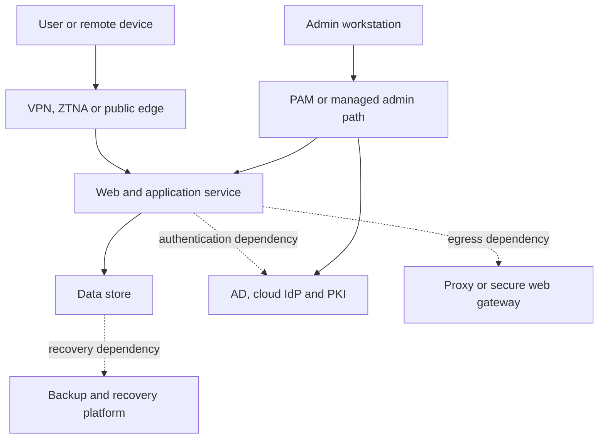

# Enterprise discovery, mapping and recording

Research and proposed operating method — 24 October 2026. This is a generic extension to the Cyber Security Cookbook, not a claim that any organisation has been discovered or assessed. No customer information, real domains, tenant IDs, configuration exports or credentials belong in this public repository.

## Who

Security engineers working with enterprise/network/cloud architects, identity and platform administrators, service/data owners, SOC, suppliers, procurement and business continuity. Assign an accountable inventory owner and a technical owner for each source. Directory read access alone is not authorisation to scan every connected network or query every tenant.

## What

Build a maintained, evidence-backed description of the organisation: **what services exist, what they depend on, where assets and identities live, how access and traffic cross boundaries, who owns them and how well that knowledge is supported**. Use linked records as the foundation; diagrams and reports are views of those records.

## Where

All agreed organisational boundaries: sites and remote users; on-premises and colocation; cloud tenants/accounts/subscriptions/projects; SaaS; suppliers and managed services; development/test/production; OT/IoT and physical dependencies. Keep real mapping data in an approved private repository/CMDB with access control and recovery. Public cookbook code and fictional examples are separate.

## When

Begin during onboarding, a merger, CAF preparation, architecture review, major migration or incident-readiness work. Refresh sources after relevant changes and on owner-agreed risk-based schedules. Treat a point-in-time export as dated evidence, not a permanently current estate.

## Why — documented foundations

This work is established practice, but no single standard or command implements the whole task:

| Foundation | Useful contribution | What it does not supply |
|---|---|---|
| NIST CSF 2.0 ID.AM | Hardware/software/services inventory, authorised communication/data-flow representations, supplier services and prioritisation [S1] | A product or prescribed database schema |
| NCSC CAF A3 | Essential-function dependencies, ownership, lifecycle and supporting infrastructure [S2] | Proof of CAF achievement from a spreadsheet alone |
| NCSC network security and zero-trust principles | Understand architecture, identities and access; do not grant implicit trust just for network location [S3,S4] | A universal red/amber/green zoning convention |
| CIS Controls 1 and 2 | Enterprise and software inventory, including cloud/remote assets [S5] | A complete business-dependency graph |
| NHS segmentation guidance | Inventory functionality, criticality and communications before segmentation [S6] | A requirement to use the same segments in every industry |
| Microsoft enterprise access model | Distinguish control, management and workload planes plus user/application/privileged access paths [S7] | A reason to treat an AD tier, VLAN and security zone as identical |

Our schema, example colour legend, source precedence and workflow below are **proposed engineering choices**, not text prescribed by those sources. See [sources.md](sources.md) for primary documentation and research limits.

## How — produce seven connected views

| View | Questions answered | Main evidence |
|---|---|---|
| Business/service dependency | What fails if this component disappears? Who approves change? | Owner interviews, service catalogue, BIA, recovery runbooks, dependency telemetry |
| Physical and virtual estate | Which sites, hosts, racks, links and platforms deliver it? | Network/DCIM inventory, hypervisors, server/endpoint management, facilities and carriers |
| Network and boundaries | Which VLAN/VRF/subnet/VNet/VPC is it in? What separates it? | IPAM, switches/routers/SD-WAN, routes, firewalls, cloud APIs |
| Identity and administration | Who/what can authenticate, administer or change policy? | AD/Entra/IdP, IAM/PAM, PKI, management systems, CI/CD and supplier access |
| Application and data | Where are the web/API/app/DB/storage layers and sensitive data? | Application owners, platforms, data catalogue, API gateways, DB/storage inventory |
| Traffic and dependencies | What is intended, configured, observed or tested? | Approved flow matrix, policy exports, flow/proxy/DNS logs, scoped validation |
| Assurance and coverage | What is known, stale, contradictory or uncollected? | Collection ledger, evidence register, reconciliation queue, owner sign-off |

A drawing alone cannot answer all seven. Use stable IDs and relationship edges so a service can depend on a cloud identity provider, an on-premises DNS resolver, a proxy policy and a supplier even when those do not share one network segment.

## A practical discovery sequence

1. **Agree scope and vocabulary.** List legal/business entities, essential functions, sites, tenants/accounts, suppliers, OT restrictions, exclusions, collection accounts and maintenance windows. Establish who can approve each source and any active tests. Scope discovery and authorisation to test are separate records.
2. **Seed from owners and existing systems.** Import service catalogue, CMDB/IPAM/DCIM, procurement/contracts, IdP and cloud billing/account hierarchies. Record source permissions and missing scopes. Unknown owner is an actionable gap, not an invented value.
3. **Export authoritative configuration.** Directory, DHCP/DNS, hypervisors, network interfaces/routes, firewall and NAT rules, proxy/SWG/WAF settings, cloud resources and IAM. Use read/query APIs and an approved administration workstation. Record running versus candidate config and HA member/cluster.
4. **Add observation.** Reconcile endpoint/EDR, NAC, DHCP leases, DNS, flow, firewall/proxy logs, load-balancer pools, application traces and supplier evidence. A listening port, declared policy and observed flow are different facts.
5. **Resolve identities and conflicts.** Join by scoped immutable IDs, retaining aliases/history. Keep IP assignment time and VRF/account context. Queue incompatible source claims; do not overwrite them silently.
6. **Validate a pilot path.** Choose one business service and trace user, admin, data, management and recovery paths. Compare approved intent, effective policy, logs and a narrowly authorised test. Check both successful and explicitly prohibited flows where testing is approved.
7. **Publish controlled views and maintain.** Owners review the service/zone/flow records. Generate purpose-specific diagrams. Track unexplored areas and stale evidence separately from risk findings. Integrate change, deployment and decommission workflows.

## Read the evidence at four levels

- **Intended:** the service/owner says a flow should exist and has approved it.
- **Configured:** current collected rules/routes/identity policy appear to permit or deny it.
- **Observed:** dated logs show a connection or decision from a specific vantage/time window.
- **Validated:** a scoped test exercises the relevant path under recorded conditions.

Never turn one level into another automatically. No observed traffic may reflect a quiet batch job, log gaps or sampling. An allow rule may be shadowed; observed packets may use NAT, an alternate route or a proxy. A successful TCP test is not successful authorisation or business-service recovery.

## Worked service path — illustrative only

This diagram is a set of questions to substantiate, not an approved architecture. Each edge needs an owner, direction, protocol/application, enforcement points, identity requirements and evidence. DNS, time, monitoring, key management, power and carrier dependencies must be added where they apply. Supplier support paths need the same treatment.

## Red, amber and green: two independent uses

Use a documented local legend for **zone classification**; keep **assessment RAG** in a different field. An internet zone coloured red is not automatically an unresolved finding. A private zone coloured green is not implicitly trusted or compliant. Keep a grey/unknown state where evidence is absent. [zones-and-flows.md](zones-and-flows.md) supplies a proposed model and example flow matrix.

## Where DC commands fit

AD can seed forests, domains, sites, replication subnets, domain controllers, trust objects, registered computers and GPO context. It cannot establish all VLANs, effective firewall policy, SaaS ownership, cloud-only devices, unmanaged assets or actual business dependencies. Prefer RSAT on an approved management host over running tooling interactively on DCs. See [directory-discovery.md](directory-discovery.md) for documented commands, scope, outputs and gaps.

## Pack navigation

- [Source-by-source discovery and reconciliation](discovery-plan.md)
- [Zones, firewalls, proxies and communication records](zones-and-flows.md)
- [Directory/DC and local Windows evidence](directory-discovery.md)
- [On-premises, hybrid, cloud and SaaS](cloud-and-hybrid.md)
- [Register model, identity joins, freshness and ownership](record-model.md)
- [Local-authority working scenario and scoping questions](local-authority-scenario.md)
- [Primary research and limitations](sources.md)
- [Empty register template](templates/estate-register.json) and [fictional worked example](templates/example-estate.json)

## Definition of useful progress

For each agreed scope: record collection success/access/pagination, represented assets and identities, owner coverage, stale/conflicting/unverified claims, critical dependencies and boundary validation status. Report unknown denominators explicitly; do not publish a percentage called "organisation discovered" when the scope itself is incomplete. A source can be fully collected while the real estate remains partly unknown.

This pack documents an operating method. It has not connected to any directory, firewall, proxy, cloud tenant or corporate network. Syntax checks are not native-platform or operational validation, and this pack alone does not demonstrate conformity to a framework.
